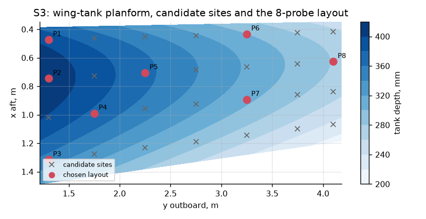
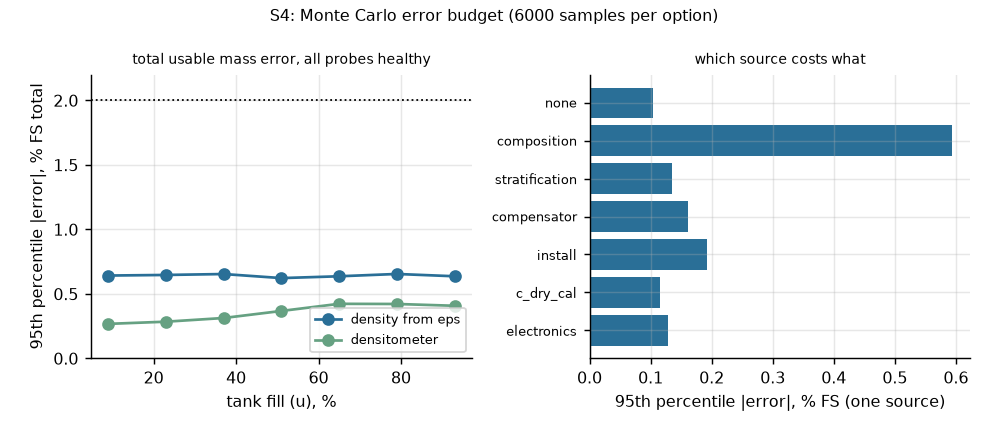
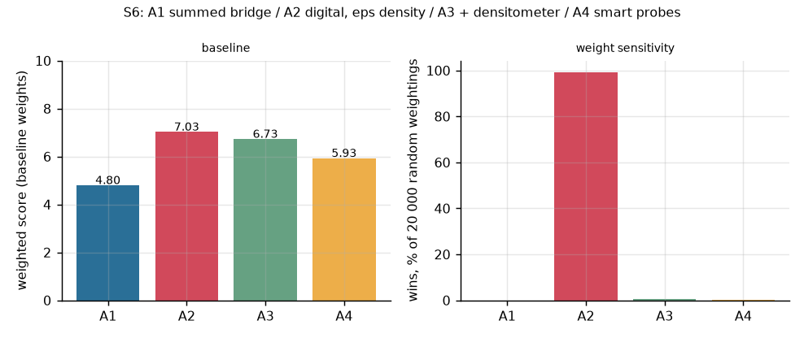
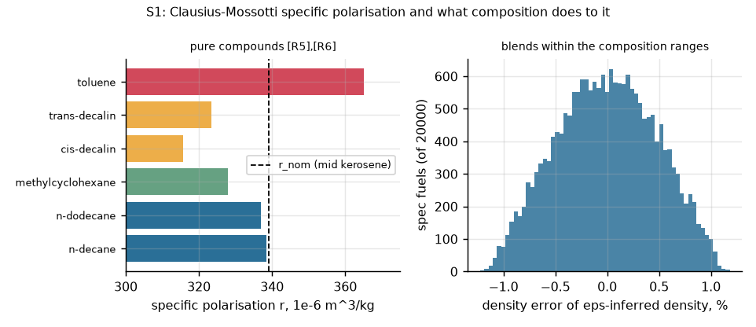
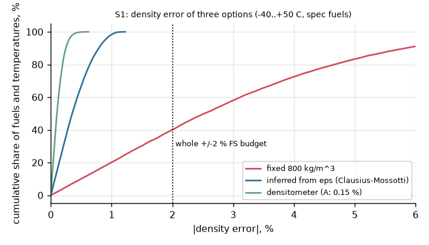
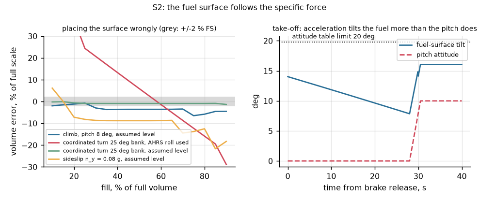
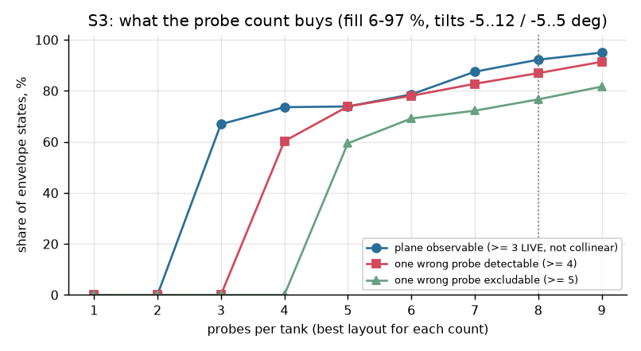
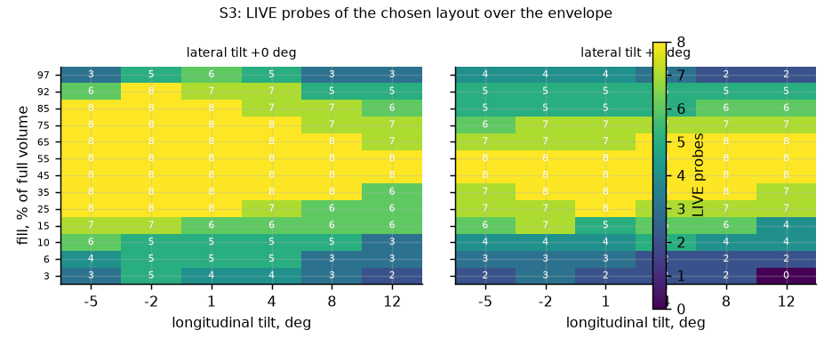
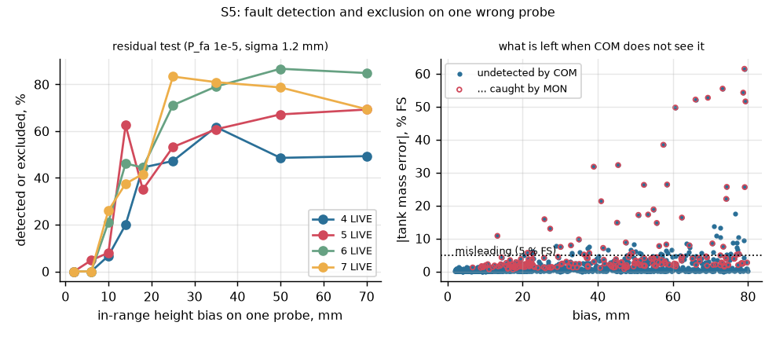
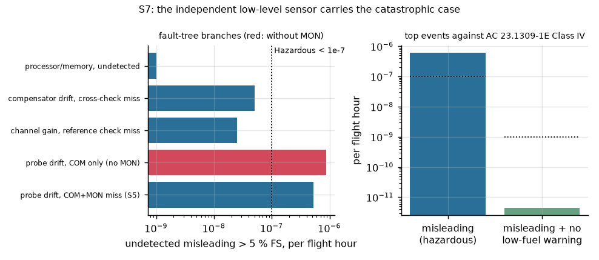

# Capacitance fuel quantity gauging for a commuter turboprop: engineering dossier

Rev A, 11 Nov 2026. Portfolio and thesis-preparation work; not a product, not certified.

The dossier follows the systems-engineering spine of Wasson, *System Engineering Analysis, Design, and Development*, 2nd ed. (Wiley, 2016) [W]. Each section names the chapter and pages it applies.

Every engineering number carries a reference key [Rn] (list in §17) and one of these statuses:
- **V:** read in the source.
- **D:** derived from V values by a stated method.
- **A:** an assumption of this study.
- **S:** a standard textbook result.

The models, the firmware and the tests that produce the results are in this repository. [docs/sources.md](docs/sources.md) is the source register.

---

## 0. The question and the short answer

**Open engineering question.** Can a capacitance gauge indicate the usable fuel *mass* within ±2 % of full scale on a twin-turboprop commuter? Three things make this hard:
- the fuel surface tilts with the aircraft's attitude and acceleration;
- the fuel's density and permittivity vary with composition and temperature;
- a probe can fail without warning.

The study then asks:
- how many probes are needed, and where they go;
- what density information is needed;
- what happens when one probe is wrong;
- whether the result can be trusted enough that the quantity indication is not the last line of defence against fuel exhaustion.

**Short answer, from the models and firmware in this repository:**

1. **Density, not geometry, sets the accuracy floor.**
   - A capacitance gauge with a compensator measures volume. Mass needs density.
   - Inferring density from the measured permittivity (Clausius–Mossotti) depends on the fuel's composition. The specific polarisation of kerosene-range paraffins, cycloparaffins and aromatics spans 3.20–3.65 × 10⁻⁴ m³/kg ([R5], [R6], D).
   - Across spec-compliant blends this gives up to **±1.2 % density error (0.89 % at the 95th percentile)**.
   - A fixed design density would be **6.7 %** wrong (95th percentile).
   - In the full Monte Carlo, composition is the largest single error source: **0.59 % FS** of a 0.65 % total (S1, S4).
2. **The surface follows the specific force, not the attitude.**
   - Using the AHRS roll angle in a 25° coordinated turn would make the gauge **64 % FS** wrong. In such a turn the fuel stays parallel to the wing.
   - Assuming level flight costs **6.5 %** at 8° of climb and **22 %** in a 0.08 g sideslip.
   - The take-off roll tilts the fuel **14°** before the nose lifts.
   - The gauge therefore fits the fuel plane to the probes themselves. It uses the measured specific force only as a fallback (S2).
3. **The probe count is set by observability and fault detection, not by accuracy.**
   - Eight probes per wing tank give:
     - **0.65 % FS** total error at the 95th percentile (**0.38 %** with a densitometer), all probes healthy, over the whole envelope;
     - **92 %** of envelope states in which the probes alone fix the plane;
     - **87 %** in which one wrong probe can be detected;
     - **77 %** in which it can be excluded.
   - Accuracy alone would be met with fewer probes plus the specific force. The extra probes buy independence from the aircraft's attitude data and the ability to see a wrong probe (S3, S4).
4. **Residual monitoring (probe-level RAIM) catches what matters, where there is redundancy.**
   - An open or shorted probe is always caught by its range. Free water at the probe foot is caught by range in 92 % of cases.
   - For in-range drift, every event that ended **misleading** (more than 5 % FS wrong and not flagged) happened with **3 or fewer LIVE probes** (6.8 % of those events). **None** happened with 4 or more.
   - After an exclusion the tank stays within **0.61 % FS** (95th percentile) (S5).
5. **Integrity is carried by architecture, not by the gauge alone.**
   - The fault tree gives **6.0 × 10⁻⁷** misleading-high events per flight hour. That meets Major (< 10⁻⁵) but not Hazardous (< 10⁻⁷) for a commuter aircraft [R3].
   - An **independent low-level sensor** with its own warning path brings the catastrophic combination (misleading quantity *and* no low-fuel warning) to **4.5 × 10⁻¹²** per flight hour, against a target of < 10⁻⁹.
   - So the gauge can be developed at DAL C (Major), provided the low-level warning stays independent (S7, §10).
6. **The firmware implements the chosen design** on an NXP i.MX RT1064 under Zephyr:
   - the weighted plane fit with leave-one-out exclusion;
   - the specific-force fallback;
   - a diverse monitor lane, compensator cross-check, low-fuel and FQ DISAGREE logic;
   - ARINC 429 output.

   Evidence (§13):
   - it matches the model on 160 back-to-back vectors with **0 mismatches**;
   - 100 % MC/DC on the host;
   - in Renode the flight profile stays within **0.66 % FS** per tank;
   - each injected probe fault is latched **0.3 s** after it appears.

---

## 1. Problem space (W ch. 4, pp. 76–98)

**Problem statement** (no solution words; W p. 92). A crew planning and flying a commuter sector cannot rely on the indicated fuel. The indicated value can be wrong when:
- the aircraft is not level, or is accelerating;
- the fuel's density is not the one the gauge assumed;
- a sensor in the tank has failed or drifted.

**Why it matters.**
- Fuel exhaustion is a recurring cause of accidents with turboprops and commuter aircraft.
- The fuel quantity indication is the crew's primary means of knowing the fuel on board, cross-checked against the fuel-flow totaliser and the flight plan.
- The certification basis requires a quantity indicator for each tank, calibrated to read zero at the unusable fuel in level flight ([R1], CS 25.1337(b) wording; the same requirement appears in the commuter-category basis).

**Need typing** (W Principle 4.12, p. 89).
- **Real need:** usable *mass* in each tank, within a stated accuracy, in every normal attitude, plus a warning before the tank runs dry.
- **Projected need:**
  - output on a digital bus (ARINC 429) for an EFIS/FMS;
  - configurable tank tables for derivative aircraft;
  - densitometer as an option for operators that fuel by mass.
- **Perceived need:** "more probes = more accurate". S3 and S4 show that past about five probes, accuracy improves little. Probes buy observability and fault detection.

**Stakeholders** (after W Table 4.2, pp. 84–85).

| Role | Concern |
|---|---|
| Pilot (user) | mass per tank and total; trustworthy low-fuel warning; a clear sign when the gauge is not to be trusted |
| Operator / dispatcher | dispatch with one probe inoperative; fuel planning by mass |
| Maintainer | a failed probe localised by BIT; no tank entry to diagnose |
| Airframe integrator | probe mass and wiring through the wing; intrinsic safety of every in-tank circuit; EMI and lightning |
| Certification authority | CS-23/CS-25 1337, the system safety assessment (AC 23.1309-1E), intrinsic safety (AC 25.981-1D), software and hardware assurance (DO-178C / DO-254) |
| Fuel supplier | any spec fuel (Jet A, Jet A-1, JP-8 and equivalents) without reconfiguration |

**Problem and solution spaces** (W Principles 4.17–4.18, Fig. 4.7, pp. 93–95). The problem space 1.0 is "fuel-on-board knowledge". It splits into these solution spaces:
- 1.1 sensing in the tank (probes, compensator, low-level sensor);
- 1.2 measurement electronics;
- 1.3 computation (surface, volume, density, mass);
- 1.4 integrity monitoring;
- 1.5 interfaces to the cockpit and the avionics.

The question of §0 is a **critical technical issue** (W p. 100): accuracy, availability and integrity have to be met by the same probe set.

## 2. Mission analysis, use cases and scenarios (W ch. 5, pp. 99–128)

**Mission statement** (W Principle 5.2): the crew knows the usable fuel mass on board, and is warned in time, for the whole flight.

**Phases** (W Principle 5.7, p. 110):
- **Pre-flight:** power-up, BIT, fuelling with indication on the refuel panel, low-level sensor test.
- **Flight:** taxi, take-off roll, climb, cruise with turns and sideslip, descent, approach.
- **Post-flight:** fault log read-out, maintenance.

**Mission event timeline** (W Fig. 5.5, p. 112):

```
t0 power on -> BIT -> t1 fuelling (quantity rising, tanks levelled) -> t2 taxi (ground slope)
-> t3 take-off roll (0.25 g, fuel tilts 14 deg) -> t4 rotation and climb (tilt up to 16 deg)
-> t5 cruise (burn, turns, sideslip) -> t6 descent (tilt -3 deg) -> t7 low fuel (sensor uncovered)
-> t8 landing, shutdown
```

**Use cases** (UCs; W Principle 5.18, p. 121):

| UC | Actor | Outcome |
|---|---|---|
| UC1 Read quantity | pilot | usable mass per tank and total, within ±2 % FS |
| UC2 Fuel the aircraft | ground crew | quantity rising on the refuel panel; stop at the target mass |
| UC3 Low-fuel warning | pilot | LOW FUEL per tank, independent of the quantity computation |
| UC4 Gauge fault | pilot, maintainer | a failed probe is excluded and the indication stays usable, or the indication is flagged (no computed data / failure warning) and never misleading |
| UC5 Disagreement | pilot | FQ DISAGREE when the low-level sensor and the gauge contradict each other |

**Scenarios used in the study.**
- The S1–S5 envelopes.
- The five Renode scenarios (`fw/sim/scenarios`): flight profile; probe faults; low fuel; compensator drift with a data gap; a low-level sensor stuck dry.

## 3. Concept of operations (W ch. 6, pp. 129–146)

**How the system is used.**
- Probes in each integral wing tank measure the wetted height of the fuel.
- A compensator at the tank bottom measures the fuel's permittivity.
- A low-level sensor (thermistor type) at the outlet tells, independently, whether the last fuel is still there.
- A gauge computer computes, every 100 ms:
  - the fuel plane;
  - the volume from an attitude table;
  - the density, from the permittivity or from a densitometer;
  - the mass.
- It sends the mass per tank and the total as ARINC 429 words to the cockpit display and the FMS. A LOW FUEL lamp discrete goes directly to the warning panel.

**What the pilot sees and does** (W Table 6.4, p. 143):

| Indication | Meaning | Crew action |
|---|---|---|
| mass, normal | trust it, cross-check with the totaliser | none |
| mass, DEGRADED status | computed with a substitute (excluded probe, fallback slopes, compensator substitute) | trust it, monitor the totaliser |
| no computed data | the gauge cannot compute | use the totaliser and the plan |
| failure warning (FQ FAIL) | COM/MON disagreement | do not use the gauge |
| LOW FUEL | sensor dry 20 s, or computed below 60 kg for 20 s | land as soon as practical |
| FQ DISAGREE | sensor dry while the gauge reads high | treat as low fuel |

## 4. Phases, modes and states (W ch. 7, pp. 147–173)

**Gauge modes** (W Principles 7.2–7.5, pp. 154–159). Each transition has an exit criterion only (W Author's Note 7.4, p. 159).

| Mode / state | Entry | Exit |
|---|---|---|
| POWER-UP / BIT | power on | reference-capacitor and table CRC check pass (hardware) |
| NORMAL | at least 3 LIVE probes, geometry good, residual passes | residual fails, too few LIVE probes, or no data |
| EXCLUDED (one probe out) | residual fails and leave-one-out isolates it, ≥ 5 LIVE | probe latched after 3 cycles; stays until power-down |
| FALLBACK (DEGRADED) | fewer than 3 LIVE probes, collinear probes, or an unverified plane contradicted by a DRY/FULL probe | plane observable again |
| INVALID (no computed data) | detected but not isolated, slopes outside the table, or nothing usable | the next cycle computes |
| FQ FAIL (failure warning) | COM/MON differ by more than 1.0 % FS for 3 s | power-down (latched) |
| NO DATA | 0.5 s without an acquisition frame | first frame |

**Allowable actions** (W Fig. 7.14, p. 171):
- No mode may raise the indication above the best estimate to "fill a gap". When the plane cannot be observed and no FULL/DRY bound is available, the output is no computed data.
- A FULL-only state reports the lowest plane that covers every FULL probe. Indicated is then less than or equal to true.

## 5. Requirements (W ch. 19–22, pp. 397–464)

These are written as subject, shall, outcome, condition (W Principle 22.5, p. 449), with one measure of performance (MOP) per requirement (W Principle 20.1, p. 418). Abnormal operations are covered: external failures, degraded operation and internal failures (W Principle 19.22, p. 411).

| ID | Requirement | Source | Verification (W Principle 13.11, p. 283) |
|---|---|---|---|
| SYS-1 | The gauge shall indicate the usable mass of each tank and the total within ±2 % of full scale for 95 % of states in the gauging envelope: surface tilt −5° to +12° longitudinal and ±5° lateral, fuel −40 to +50 °C, any spec fuel. | accuracy class (A) | Analysis (S4), test (IT01, IT02) |
| SYS-2 | The gauge shall read zero usable fuel at the unusable quantity in level flight. A LOW FUEL warning per tank shall come from a sensor independent of the quantity computation. | [R1] 25.1337(b); FHA §10 | Analysis, test (IT04) |
| SYS-3 | An undetected misleading-high indication (more than 5 % FS) shall be less probable than 10⁻⁵ per flight hour. Combined with a lost low-fuel warning it shall be less probable than 10⁻⁹. | [R3] Fig. 2, Class IV | Analysis (S5, S7) |
| SYS-4 | With any one probe failed, the gauge shall stay within ±3 % FS or flag its output. | dispatch (A) | Analysis (S5), test (IT03) |
| SYS-5 | The gauge shall output the mass per tank and the total as ARINC 429 BNR words with sign/status, and the warnings as a discrete word and a lamp discrete. | interface (A) | Test (unit, IT01) |
| SYS-6 | The gauge shall update every 100 ms, with one cycle's computation below 10 ms. | (A) | Test (IT07) |
| SYS-7 | Energy into the tank shall stay below 20 µJ in normal operation and 200 µJ under any single failure. Current shall stay below 25 mA rms in normal operation and 50 mA rms under failure. | [R2] §7.2–7.3 | Analysis (S7), test (hardware) |
| SYS-8 | The gauge shall operate from the 28 V DC bus, 22–32.2 V normal and down to 18 V in emergency, and through the DO-160G Section 16 transients. | (A); DO-160G | Test (hardware) |
| SYS-9 | The gauge shall operate from −55 to +70 °C. | (A); DO-160G Sections 4–5 | Test (hardware) |

The software requirements FQ-01 to FQ-80 ([fw/SRS.md](fw/SRS.md)) derive from these. [fw/docs/traceability.md](fw/docs/traceability.md) maps each one to its tests.

## 6. Architecture and interfaces (W ch. 26–27, pp. 542–598)

**Physical architecture** (per wing tank, both tanks the same, mirrored):

```
 [8 coaxial probes]--+                                +--> ARINC 429: labels 256/257/247 (mass), 270 (status)
 [compensator]-------+--> measurement front end -->  gauge computer (RT1064, Zephyr)
 [densitometer opt]--+    (AC ratiometric, ref. C)   |   COM: plane fit + residual test + table + density
                                                     |   MON: specific-force slopes + median + table
 [AHRS: specific force over ARINC 429] ------------->+--> LOW FUEL lamp discrete (either tank)
 [low-level sensor]---- separate channel ----------->+    FQ DISAGREE, FQ FAIL in the status word
```

**Probe layout** (S3; `model/fqsim/design.py`, `docs/img/s3_layout.png`). Positions are in the tank frame: x aft of the root leading edge, y outboard.

| Probe | x (m) | y (m) | bottom z (m) | active length (m) | C dry / full at ε 2.13 (pF) |
|---|---|---|---|---|---|
| P1 | 0.473 | 1.30 | −0.153 | 0.375 | 89.5 / 187.3 |
| P2 | 0.746 | 1.30 | −0.165 | 0.398 | 94.8 / 198.6 |
| P3 | 1.316 | 1.30 | −0.133 | 0.335 | 80.2 / 167.6 |
| P4 | 0.990 | 1.75 | −0.134 | 0.359 | 85.8 / 179.4 |
| P5 | 0.705 | 2.25 | −0.116 | 0.349 | 83.6 / 174.7 |
| P6 | 0.433 | 3.25 | −0.057 | 0.284 | 68.4 / 142.5 |
| P7 | 0.893 | 3.25 | −0.059 | 0.288 | 69.5 / 144.8 |
| P8 | 0.627 | 4.10 | −0.024 | 0.263 | 63.6 / 132.1 |

- The probes are coaxial tubes with r_i = 11 mm and r_o = 14 mm, giving 230.7 pF/m ([R11], D). There is an 8 mm dead zone at each end (A).
- The compensator is 80 mm long at the tank bottom: 18.5 pF per unit of (ε − 1).



**Computation chain** (one tank, one cycle; [fw/lib/fq/src/solve.c](fw/lib/fq/src/solve.c), specified by [model/fqsim/gauge.py](model/fqsim/gauge.py)):

1. **ε from the compensator,** accepted in [1.85, 2.45].
   - The left/right cross-check flags a difference over 0.03. Both tanks then use the larger ε, which gives the lower mass.
   - The fallback order is: the other tank, the last good value, the default 2.13.
2. **Classify each probe** from its capacitance as OPEN, SHORT/WATER, DRY, FULL or LIVE.
   - The FULL band is relative (2.5 % of the length). A full probe reads short by up to 2 % through gain and stratification (S4).
3. **Weighted least-squares plane** through the LIVE probes.
   - The weights are 1/(σ0² + (κh)²), with σ0 = 1.2 mm and κ = 1.2 % of the wetted height h.
   - The fit is accepted only if the weighted position covariance has a determinant of at least 3 × 10⁻³ m⁴. A tight cluster of probes extrapolates badly (S3).
4. **Residual test** with n ≥ 4 LIVE probes: χ² against the threshold for n − 3 degrees of freedom, P_fa = 10⁻⁵.
   - With n ≥ 5, leave-one-out picks the probe to exclude.
   - If the remaining probes do not pass, the result is invalid.
5. **DRY/FULL consistency** with the plane (15 mm).
   - A disagreement with an unverified plane drops that plane, and the gauge uses the fallback.
6. **Fallback.** The slopes come from the measured specific force (AHRS), or else from the last verified plane. The height is the mean of the LIVE probes, or the conservative bound.
7. **Attitude table:** 25 × 17 × 65 points over slope × slope × normalised height (110 kB of flash), trilinear interpolation. Then subtract the unusable volume.
8. **Density** from ε by Clausius–Mossotti with r_nom = 3.390 × 10⁻⁴ m³/kg, or from the densitometer. **Mass** = usable volume × density.
9. **Monitor lane** (MON, diverse): slopes from the specific force, height from the median of the LIVE probes, the same table.
   - COM and MON must agree within 1.0 % FS for 3 s, or the gauge enters FQ FAIL.
10. **Persistence:** a range fault, an exclusion or a DRY/FULL contradiction that lasts 3 cycles latches the probe as failed until power-down.
11. **Filter:** τ 8 s. The value is held while invalid and dropped after 3 s.

**Interfaces** (W Figs. 27.4/27.5, p. 590):

| Interface | Content | Rate | Note |
|---|---|---|---|
| Probes → front end | AC excitation 5 V rms at 10 kHz; ratiometric against a reference capacitor | continuous | series 1 kΩ per in-tank line (§7.3) |
| Front end → computer | capacitances of 16 probes and 2 compensators (0.01 pF), flags | 10 Hz | in the test setup: the acquisition frame on LPUART3 (`fw/sim/rig.py`) |
| AHRS → computer | body specific force f_x, f_y, f_z (mg) and validity | 10 Hz | ARINC 429 on a real unit; in the acquisition frame here |
| Low-level sensors → computer | wet/dry per tank | 10 Hz | separate channel |
| Computer → cockpit / FMS | ARINC 429 labels 256, 257, 247 (BNR, 18 bits, 4096 kg), label 270 (discrete) | 10 Hz | labels are an assumption of this study (A) |
| Computer → warning panel | LOW FUEL lamp discrete | — | GPIO |

## 7. Performance budgets and margins (W ch. 31, pp. 666–681)

### 7.1 Accuracy budget (S4: Monte Carlo, both tanks, 6000 samples per option)

The total error is the indicated minus the true usable mass, as a percentage of the 1487.8 kg total full scale.

| Option | 95th percentile | Max | Margin to ±2 % |
|---|---|---|---|
| density from ε (chosen) | **0.65 %** | 1.86 % | 1.35 % |
| densitometer | **0.38 %** | 1.35 % | 1.62 % |

One source at a time (95th percentile, % FS):

| Source | p95 |
|---|---|
| fuel composition (r spread) | 0.59 |
| installation height ±1 mm | 0.19 |
| compensator | 0.16 |
| stratification 0–10 K | 0.14 |
| front-end offset and gain | 0.13 |
| C_dry calibration | 0.12 |
| none (table interpolation and plane fit only) | 0.10 |



**Margin.** The budget is dominated by composition. A densitometer halves the total, at the cost of one more in-tank part per tank (§8).

The residual-test sigmas were set from the same Monte Carlo:
- 8100 healthy residual tests gave **0 false alarms**;
- the largest χ²/threshold was 0.58, a factor of 1.7 in χ² below the alarm.

### 7.2 Timing budget

| Item | Budget | Measured |
|---|---|---|
| Cycle | 100 ms | 100 ms (k_timer) |
| Computation of one cycle (both tanks, COM + MON) | 10 ms | 118 µs worst case in Renode (IT07, 600 MHz virtual) |
| Fault latch | 3 cycles | 0.3 s after the fault appears (IT03) |
| LOW FUEL persistence (slosh) | 20 s | 19.9 s after the sensor goes dry (IT04) |
| NO DATA | 0.5 s | 0.5 s (IT05) |

### 7.3 Intrinsic safety budget (S7, against [R2] §7.2–7.3)

| Quantity | Design value | Limit | Status |
|---|---|---|---|
| Stored energy, normal operation (250 pF probe + 480 pF harness at 7.1 V peak) | 0.018 µJ | 20 µJ (target), 50 µJ | D |
| Excitation current, normal | 0.23 mA rms | 25 mA rms | D |
| Hot short of a 32.2 V wire to a probe line, through 1 kΩ | 32.2 mA | 50 mA rms (failure) | D |
| Energy stored at 32.2 V | 0.38 µJ | 200 µJ (failure) | D |
| Cost of the 1 kΩ: RC time constant / phase shift at 10 kHz | 0.73 µs / 2.6° | taken out by the ratiometric measurement | D |

The 1 kΩ series resistor is set by the failure current limit, not by the energy limit.

### 7.4 Memory

- Attitude table: 27 625 floats = 110 kB. Generated file `fq_data.c`.
- Firmware image: 161 kB of the RT1064's 4 MB flash; 18 kB of RAM.

## 8. Analysis of alternatives (W ch. 32, pp. 682–702)

| Alternative | Description |
|---|---|
| A1 | Classic summed-probe bridge: one capacitance bridge per tank, probes in parallel, calibrated in level attitude, density inferred |
| **A2** | Digital gauge computer: probes on their own channels, plane fit, residual test, monitor lane, density from ε (**this design**) |
| A3 | A2 with a densitometer in each tank |
| A4 | Smart digital probes with electronics inside the tank on a bus, with the A3 algorithm |

The criteria are weighted (A, baseline). Accuracy and integrity are mapped from the computed numbers:
- accuracy: score = 10 − 3 × (95th-percentile % FS);
- integrity: score = 10 − 400 × (share of misleading in-range faults).

The other scores are judged and their reasons are given below.

| Criterion | Weight | A1 | A2 | A3 | A4 |
|---|---|---|---|---|---|
| accuracy (p95 % FS: 8.50 / 0.65 / 0.38 / 0.38) | 0.25 | 1.0 | 8.1 | 8.9 | 8.9 |
| integrity (no redundancy / 1.2 % misleading) | 0.25 | 2.0 | 5.1 | 5.1 | 5.1 |
| intrinsic safety (powered electronics in the tank for A4) | 0.15 | 9 | 9 | 8 | 4 |
| mass and wiring | 0.10 | 9 | 7 | 6 | 8 |
| development and certification cost (complex hardware in the tank for A4) | 0.15 | 8 | 6 | 5 | 3 |
| maintainability (BIT localises a probe) | 0.10 | 6 | 8 | 7 | 6 |
| **weighted** | | 4.80 | **7.03** | 6.73 | 5.93 |



**Sensitivity** (W Table 32.1, p. 691).
- Over 20 000 random Dirichlet weightings around the baseline, A2 wins **99.3 %** and A3 0.7 %.
- No ±10 % change of a single weight changes the winner.

**Recommendation:**
- A2.
- Make the densitometer (A3) a **customer option** for operators that fuel by mass. It cuts the error from 0.65 to 0.38 % FS.
- The summed bridge (A1) cannot meet ±2 % across the attitude envelope: its 95th-percentile error is 8.5 %.

## 9. Modelling and simulation (W ch. 33, pp. 703–720)

### 9.1 M&S plan

| Study | Question | Model | Validation |
|---|---|---|---|
| S1 | what density error does the fuel cause? | Clausius–Mossotti with compound data [R5], [R6] | ε ≈ n² check for n-dodecane (1.5 %); α from two independent compounds (8.6 and 7.9 × 10⁻⁴ /K) |
| S2 | where does the surface go? | column-integrated tank with a NACA section [R9] | volume against a direct sum, monotonicity, inversion (tests) |
| S3 | how many probes and where? | LIVE matrix over 390 envelope states, greedy search with swap refinement | layout re-checked by S4 (no invalid state in 6000 samples) |
| S4 | total error | full measurement chain with errors drawn per sample | noise-free run: 0.10 % (table only) |
| S5 | one wrong probe | S4 plus injected faults | chi-square false-alarm count on healthy data |
| S6 | which architecture? | weighted AoA with weight Monte Carlo | — |
| S7 | is it safe enough? | fault tree with S5 coverages, intrinsic-safety calculation | — |
| S8 | firmware data | export of the tables, configuration, vectors and scenarios | back-to-back test, 160/160 |

The software in the loop is the C library, run against the model on exported vectors and in Renode on exported scenarios (§13).

### 9.2 S1: the fuel



**Specific polarisation by class** (D from [R5], [R6]; × 10⁻⁴ m³/kg):

| Compound | r |
|---|---|
| n-decane | 3.385 |
| n-dodecane | 3.370 |
| methylcyclohexane | 3.280 |
| cis-decalin | 3.157 |
| trans-decalin | 3.233 |
| toluene | 3.652 |

- Toluene stands out because it is weakly polar: its static ε exceeds n².
- **Spec blends** (composition A): r falls between −1.22 % and +1.18 % of r_nom.
- **The nominal fuel:** ε = 2.131 at 15 °C. Across fuels and −40 to +50 °C, ε ranges from 2.012 to 2.291.
- **Temperature coefficient:** dε/dT = −1.3 × 10⁻³ /K.



**What it means:**
- A compensator makes temperature drop out: ε tracks density at the tank bottom.
- Composition stays in. It is invisible to a permittivity measurement, because it changes r, not ρ.
- Only a densitometer, or a density entered at refuelling, removes it.

### 9.3 S2: the surface



| Way of placing the surface | Worst error over 10–90 % fill |
|---|---|
| assume level, climb at 8° | 6.5 % FS |
| tilt by the AHRS roll angle in a 25° coordinated turn | 64 % FS |
| assume level in a 25° coordinated turn (2° nose-up) | 1.4 % FS |
| assume level, sideslip n_y = 0.08 g | 22 % FS |
| plane fit (this design), noise-free, whole envelope | 0.14 % FS |

The surface tilt is atan((a + g sin θ)/(g cos θ)). On the take-off roll it is 14° at brake release (0.25 g) and 16° at most, inside the table's 19.8°.

### 9.4 S3: probe count and placement



Shares of the 360 envelope states with fill 6–97 %:

| Probes per tank | Plane observable | One fault detectable | One fault excludable |
|---|---|---|---|
| 3 | 66.9 % | 0 | 0 |
| 4 | 73.6 % | 60.3 % | 0 |
| 5 | 73.9 % | 73.9 % | 59.4 % |
| 6 | 78.6 % | 78.1 % | 69.2 % |
| 7 | 87.5 % | 82.8 % | 72.2 % |
| **8** | **92.2 %** | **86.9 %** | **76.7 %** |
| 9 | 95.0 % | 91.4 % | 81.7 % |



**The rule used:** the smallest count at which the probes alone observe the plane in at least 90 % of states. That gives 8.

**What the coverage does not reach:**
- the near-full region, over 90 % fill, where the surface is above most probe tops;
- the near-empty region, under 7 % fill.

The first uses the specific force as a fallback. The second is covered by the independent low-level sensor.

### 9.5 S4: the Monte Carlo

See §7.1. The fallback carries the high- and low-fill states that the probes alone cannot observe (§9.4). Across the 12 000 tank evaluations, no output was invalid.

### 9.6 S5: one wrong probe



| Fault (events) | Range check | Excluded | Detected only | Undetected | Misleading, COM only | Misleading after MON |
|---|---|---|---|---|---|---|
| open (296) | 100 % | — | — | — | 0 | 0 |
| short (295) | 100 % | — | — | — | 0 | 0 |
| water at foot, 0.5–40 mm (574) | 92.2 % | 2.8 % | 0.5 % | 4.5 % | 0.70 % | 0.35 % |
| in-range bias 2–80 mm (2916) | 5.6 % | 46.5 % | 4.3 % | 41.6 % | 2.71 % | **1.23 %** |
| gain drift 2–40 % (1459) | 0.5 % | 43.6 % | 3.6 % | 50.8 % | 2.88 % | **2.06 %** |

**Where the misleading events are** (bias and gain drift together):

| LIVE probes at the event | Events | Misleading after MON |
|---|---|---|
| 3 or fewer | 968 | 6.8 % |
| 4 | 385 | **0** |
| 5 or more | 3022 | **0** |

- The undetected events with 4 or more LIVE probes are small biases, which stay below 5 % FS.
- After an exclusion the tank stays within 0.61 % FS (bias) and 0.64 % FS (gain), 95th percentile.
- MON limit: the healthy COM–MON gap is 0.61 % FS at the 99.9th percentile, so the limit is set at 1.0 % FS.

## 10. Reliability, maintainability, availability (W ch. 34, pp. 721–791)

**Functional hazard assessment** (classification A, after [R3] Fig. 2, Class IV):
- For a Class I single-engine aircraft, [R3] Appendix 1 rates misleading fuel indication as Minor, because the pilot plans fuel independently.
- For a commuter, this study takes a more severe view: misleading-high fuel in **both** tanks, undetected, is **Hazardous** if no other warning exists, and **Catastrophic** combined with a lost low-fuel warning.

**Fault tree** (S7; failure rates A, order of magnitude; coverages from S5 and §6):

| Branch | Per flight hour |
|---|---|
| probe in-range drift (16 × 2 × 10⁻⁶ /h), missed by COM and MON | 5.3 × 10⁻⁷ |
| (the same, COM only, no MON) | (8.7 × 10⁻⁷) |
| measurement channel common-mode gain (5 × 10⁻⁶ /h), 99 % reference-check coverage | 2.5 × 10⁻⁸ |
| compensator drift (2 × 10⁻⁶ /h), 95 % cross-check coverage | 5.0 × 10⁻⁸ |
| processor/memory (2 × 10⁻⁶ /h), 99.9 % coverage | 1.0 × 10⁻⁹ |
| **misleading high, undetected** | **6.0 × 10⁻⁷** |
| low-level warning unavailable (5 × 10⁻⁶ /h, latent, tested every 3 h flight) | 7.5 × 10⁻⁶ per flight |
| **misleading high and no low-fuel warning** | **4.5 × 10⁻¹²** |



**Finding:**
- The gauge alone meets Major (< 10⁻⁵) but not Hazardous (< 10⁻⁷).
- The independent low-level sensor carries the catastrophic case with three orders of magnitude to spare.
- That supports **DAL C** for the gauge software, as the primary system for a Major condition [R3]. It also makes the **independence of the low-fuel path a design constraint**: a separate sensor, a separate channel and a separate lamp discrete, with no common software.

**Improvement path** (§16):
- All misleading drift events occur with 3 or fewer LIVE probes, so two more probes at the outboard top would reduce the dominant branch further.
- So would restricting high-fill indication to "≥ value" when the plane is not observed.

**FMEA (extract)** (W Fig. 34.20, p. 766):

| Item | Failure mode | Effect | Detection | Mitigation |
|---|---|---|---|---|
| probe | open (connector) | no reading | range: C < C_dry − 2 pF | latch, exclude (IT03) |
| probe | short or water at the foot | very high reading | range: above the full value at ε 2.45 | latch, exclude (IT03) |
| probe | in-range drift (film, leakage) | wrong height | residual test (≥ 4 LIVE), MON | exclude; FQ FAIL |
| compensator | drift | all heights and the density wrong together | left/right cross-check | larger ε (lower mass), XCOMP (IT05) |
| front end | gain drift | all probes scaled | reference capacitor every cycle (hardware) | channel fail → no computed data |
| AHRS | wrong specific force | fallback and MON wrong | COM/MON comparison | FQ FAIL (unit test `test_monitor_fail`) |
| low-level sensor | stuck dry | false LOW FUEL | FQ DISAGREE (60 s) | crew treats it as low fuel (IT06) |
| low-level sensor | stuck wet | no sensor warning | pre-flight test (latent) | the computed LOW FUEL path still works |
| acquisition link | lost | no data | 0.5 s timeout | no computed data (IT05) |

**Reliability.** Parts-count style (W Principle 34.28, pp. 760–761):
- sum of rates 1.04 × 10⁻⁴ /h, so MTBF is about **9600 h**;
- **77 %** of failures are single-probe failures, which the gauge tolerates by exclusion. These are candidates for dispatch relief with one probe inoperative (S5: within 0.61 % FS after exclusion).

## 11. Qualification plan (hardware; not done in this repository)

| Area | Standard | Test |
|---|---|---|
| Power input | DO-160G Section 16 | 22–32.2 V normal, 18 V emergency, surges and drop-outs |
| Lightning, induced | DO-160G Section 22 | pin injection on the in-tank lines; the series resistors and clamps must hold 125 mA peak into the tank [R2] |
| Temperature | DO-160G Sections 4–5 | −55 to +70 °C (SYS-9) |
| Fluids | DO-160G Section 11 | fuel compatibility of probe materials |
| Explosion | DO-160G Section 9 | in-tank parts |
| Intrinsic safety | AC 25.981-1D | energy and current measured, including under failure, against §7.3 |
| Calibration | — | tank calibration by metered fuelling at several attitudes, to check the 110 kB table |

## 12. Software assurance: DO-178C-style plans and evidence

**Level.** The gauge software is the primary system for a Major condition. With the independent low-fuel path, that is DAL C ([R3], §10).

**Objectives addressed in this repository:**
- requirements with IDs, traced to tests ([fw/SRS.md](fw/SRS.md), [fw/docs/traceability.md](fw/docs/traceability.md); 34/34 traced);
- structural coverage: 100 % statement, branch and MC/DC on the host, GCC 14 `-fcondition-coverage`. MC/DC is a DAL A objective; DAL C needs statement coverage only;
- coding standard: MISRA C:2012 via cppcheck. Two advisory deviations are documented ([fw/docs/misra.md](fw/docs/misra.md));
- the algorithm specified in an executable model ([model/fqsim/gauge.py](model/fqsim/gauge.py)) and verified back to back (160 vectors);
- integration tests on the target processor model (Renode).

**Not addressed:**
- independence of verification;
- qualified tools;
- configuration management and problem reporting to a plan;
- the hardware (DO-254) side.

## 13. Verification and validation (W ch. 13, pp. 270–292; ch. 28, pp. 599–622)

### 13.1 Strategy

- **Verification** (W Principles 13.3/13.4, p. 275) is against SYS-1 to SYS-9 and FQ-01 to FQ-80, using the fewest methods that prove compliance (W Principle 13.11, p. 283):
  - analysis for accuracy and integrity (Monte Carlo);
  - test for behaviour (host and Renode).
- **Validation** would be done by:
  - flight-test calibration against metered fuel;
  - comparison with the fuel-flow totaliser;
  - crew evaluation of the indications in §3 (W Principle 13.14, p. 289).

### 13.2 Evidence produced in this repository

| Check | Result |
|---|---|
| Model tests (`model/tests`) | 15 tests: Clausius–Mossotti, NACA section, column integration, specific-force tilt, coaxial capacitance, the gauge without errors, exclusion, COM/MON, and firmware constants equal to the model |
| Host unit tests (`fw/scripts/test-host.sh`) | 417 checks; **100 % lines (634), branches (356), MC/DC condition outcomes (356)** |
| Back-to-back (`test_vectors.c`) | 160 vectors from `gauge.py`: **0 mismatches** (decisions exact; plane 0.2 mm, volume 0.01 % FS, mass 0.1 kg) |
| MISRA C:2012 | no findings outside D1, D2 |
| Traceability | 34/34 requirements traced to existing tests |
| Renode IT01 | normal SSM from the first frames; 3.0 kg error; A429 parity 0 errors |
| Renode IT02 flight profile | max 4.9 kg per tank (0.66 % FS) over 120 s, including the take-off roll; no fault latched |
| Renode IT03 probe faults | open, +30 mm drift and 3 mm water each latched 0.3 s after onset; max error 2.0 kg |
| Renode IT04 low fuel | LOW FUEL 19.9 s after the sensor went dry; lamp on |
| Renode IT05 compensator drift and data gap | XCOMP after 0.1 s; never more than 0.5 % FS high; NO DATA 0.5 s into the gap; normal after it |
| Renode IT06 sensor stuck dry | LOW FUEL at 20 s, FQ DISAGREE at 60 s |
| Renode IT07 cycle time | 118 µs worst case (Renode virtual time) |
| Defects found by tests | a BNR rounding defect (−0.001 kg encoded as −4096 kg); a model/firmware status mismatch; a FULL-band and a geometry weakness in the model (see [fw/SRS.md](fw/SRS.md)) |

## 14. What is sourced, what is assumed, and the limits

**Sourced:**
- the intrinsic-safety limits [R2];
- the probability classes [R3];
- the permittivities [R5] and densities [R6] of the compounds;
- the jet-fuel density range [R7];
- the NACA section [R9];
- the physical constants [R10].

**Assumed:**
- the tank geometry (no particular aircraft);
- the probe dimensions;
- the measurement errors;
- the composition ranges;
- the failure rates;
- the envelope;
- the ARINC labels.

Each is listed in [docs/sources.md](docs/sources.md) with its reason.

**Limits:**
- **The tank is a single compartment** with vertical walls. Ribs with baffle check valves, wing bending, and fuel trapped between bays are not modelled.
- **Slosh and dynamic surfaces are not modelled.** The 8 s filter is an assumption.
- **The composition model mixes ideal class averages.** It is not a fuel-property database.
- **The low-level sensor is a discrete with a fixed threshold.**
- **The front end is not modelled in Renode.** The acquisition frame stands in for it. Cycle times are Renode virtual time.
- **Not certified.** The process is DO-178C *style* only.

## 15. Decision log

| ID | Decision | Reason | Evidence |
|---|---|---|---|
| D1 | Fit the plane to the probes; use the specific force only as fallback and in MON | attitude is the wrong input (64 % FS in a turn); probes give independence | S2 |
| D2 | 8 probes per tank, layout from S3 | 90 % observability rule | S3 |
| D3 | Geometry threshold 3 × 10⁻³ m⁴ | clustered planes gave 2.2 % FS errors and 0.8 % invalid states | S4 rerun |
| D4 | Relative FULL band (2.5 %) | a full probe reading 2 % short caused a 48 mm residual | S4 |
| D5 | Weighted residual σ² = σ0² + (κh)², with σ0 = κ = 1.2 | stratification and compensator errors scale with height; 0 false alarms in 8100 tests | S4 |
| D6 | Density from ε; densitometer as an option | 0.65 % FS meets ±2 % with margin; A2 wins the AoA | S1, S4, S6 |
| D7 | Diverse MON lane, limit 1.0 % FS for 3 s | halves the misleading drift branch | S5, S7 |
| D8 | Larger ε on compensator disagreement | lower mass: never misleading high | §6, IT05 |
| D9 | Low-level sensor independent of the computation | carries the catastrophic case; allows DAL C | S7 |
| D10 | Conservative bound in FULL-only states | indicated ≤ true when the plane is not observable | FQ-17 |

## 16. Open engineering questions, and why they matter to a gauging-system maker

1. **Near-full integrity.** All misleading drift events happen with 3 or fewer LIVE probes, mostly above 90 % fill. The options are:
   - two short probes at the outboard top;
   - reporting "at least" until the plane is observed after fuelling.
2. **Density at refuelling.** Composition dominates the budget. An uplink of the refuelled density (from the fuel truck's ticket) would remove most of it without a densitometer.
3. **Tank calibration effort.** The table could be built from CAD and checked at a few attitudes, instead of being measured fully on the aircraft.
4. **Multi-bay tanks.** With baffle check valves, the bays fill and empty in sequence, so the single-plane model needs one plane per bay.
5. **Ultrasonic or optical probes**, for tanks where intrinsic safety or water contamination limits capacitance probes.

## 17. References

- [W] Wasson, C. S. (2016). *System Engineering Analysis, Design, and Development*, 2nd ed. Wiley. Page numbers are printed pages.
- [R1] EASA CS-25 / 14 CFR 25.1337(b), "Powerplant instruments — fuel quantity indicator" (the commuter-category basis has the equivalent paragraph).
- [R2] FAA (2018). AC 25.981-1D, *Fuel Tank Ignition Source Prevention Guidelines*. §7.2–7.3.
- [R3] FAA (2011). AC 23.1309-1E, *System Safety Analysis and Assessment for Part 23 Airplanes*. Fig. 2, Appendix 1.
- [R4] RTCA (2011). DO-178C, *Software Considerations in Airborne Systems and Equipment Certification*. RTCA (2010). DO-160G, *Environmental Conditions and Test Procedures for Airborne Equipment*. (Structure only; not read.)
- [R5] Maryott, A. A., & Smith, E. R. (1951). *Table of Dielectric Constants of Pure Liquids*. NBS Circular 514.
- [R6] Compound data pages (n-decane, n-dodecane, methylcyclohexane, decalin, toluene), Wikipedia, read 11 Nov 2026.
- [R7] "Jet fuel", Wikipedia (specification table), read 10 Nov 2026; ASTM D1655 (not read).
- [R8] Böttcher, C. J. F. (1973). *Theory of Electric Polarization*, vol. I. Elsevier. Jackson, J. D. *Classical Electrodynamics*, §4.5.
- [R9] Abbott, I. H., von Doenhoff, A. E., & Stivers, L. S. (1945). *Summary of Airfoil Data*. NACA Report 824.
- [R10] CODATA 2018 recommended values.
- [R11] Coaxial capacitor: any electromagnetics textbook (e.g. Jackson, §1.13).
- MISRA C:2012. SAE ARP4754A / ARP4761 (process structure). ARINC 429 Part 1 (word layout as widely published).
