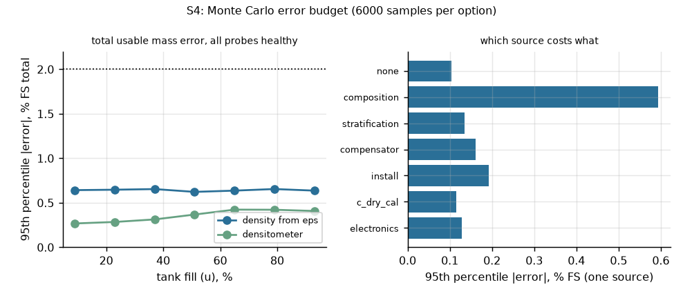
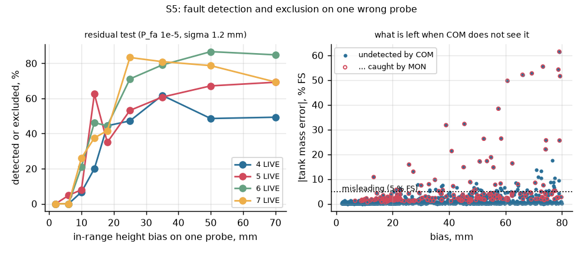
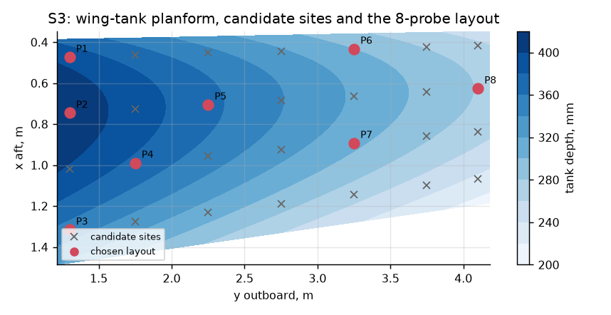
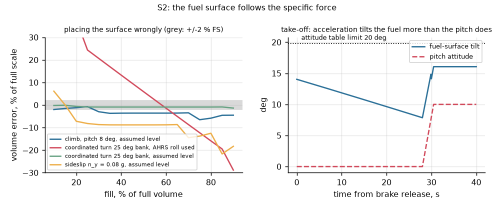

# Capacitance fuel quantity gauging for a commuter turboprop

[](https://github.com/chad416/aircraft-fuel-quantity-gauging/actions/workflows/ci.yml)

This repository studies one engineering question.

**The question:** can a capacitance gauge indicate the usable fuel *mass* of a twin-turboprop's wing tanks within ±2 % of full scale? It has to do so while the fuel surface tilts with attitude and acceleration, the fuel's density and permittivity vary with composition and temperature, and a probe can fail without warning. And can the indication be trusted enough that it is not the last line of defence against fuel exhaustion?

**What it contains:**
- **[DOSSIER.md](DOSSIER.md)** ([PDF](DOSSIER.pdf)): the engineering dossier. It follows Wasson's systems-engineering spine:
  - mission and use cases;
  - modes and states;
  - requirements traced to CS 25.1337, AC 25.981-1D (intrinsic safety) and AC 23.1309-1E (system safety);
  - architecture and interfaces;
  - budgets and margins;
  - analysis of alternatives;
  - modelling and simulation;
  - fault tree and FMEA;
  - verification and validation.
- **`model/`**: the Python models that answer the question:
  - S1: fuel permittivity and density by Clausius–Mossotti from pure-compound data;
  - S2: the fuel surface under attitude and acceleration;
  - S3: probe count and placement;
  - S4: Monte Carlo error budget;
  - S5: fault detection and exclusion;
  - S6: trade study;
  - S7: fault tree and intrinsic safety;
  - S8: export to the firmware.
- **`fw/`**: gauge-computer firmware in C99 for an NXP i.MX RT1064 on Zephyr:
  - weighted fuel-plane fit with residual-based fault detection and exclusion;
  - specific-force fallback;
  - attitude-table volume;
  - a diverse monitor lane;
  - compensator cross-check, low-fuel and FQ DISAGREE logic;
  - ARINC 429 output words.

  It is tested back to back against the model, with 100 % MC/DC on the host, and in the Renode emulator on replayed flight scenarios.

It is a portfolio and thesis-preparation project, not a product, and not certified.



## Findings

| Question | Answer | Evidence |
|---|---|---|
| What limits accuracy? | **The fuel's composition, not the geometry.** Mass needs density. Density inferred from the measured permittivity (Clausius–Mossotti) is off by up to ±1.2 % across spec fuels (0.89 % at the 95th percentile), because paraffins, cycloparaffins and aromatics polarise differently. A fixed design density would be 6.7 % off. | S1, DOSSIER §9.2 |
| Does it meet ±2 % FS? | Yes. The total usable-mass error, 95th percentile over the whole envelope, is **0.65 % FS**, or **0.38 % FS** with a densitometer. Composition alone contributes 0.59 %. There were 0 false alarms in 8100 healthy residual tests. | S4, DOSSIER §7.1 |
| Where is the fuel surface? | **Normal to the specific force, not to the attitude.** Using the AHRS roll angle in a 25° coordinated turn would be 64 % FS wrong. Assuming level flight gives 6.5 % at 8° of climb and 22 % in a 0.08 g sideslip. The take-off roll tilts the fuel 14° before rotation. The gauge therefore fits the plane to its own probes. | S2, DOSSIER §9.3 |
| How many probes? | **8 per tank, chosen for observability and fault detection, not accuracy.** The probes alone fix the plane in 92 % of envelope states. One wrong probe is detectable in 87 % of states and excludable in 77 %. | S3, DOSSIER §9.4 |
| Is a wrong probe caught? | Open and short probes always are. Water at the foot is caught by the range check in 92 % of cases. For in-range drift, **every misleading event (> 5 % FS, unflagged) had 3 or fewer LIVE probes. With 4 or more there were none.** After an exclusion the tank stays within 0.61 % FS. | S5, DOSSIER §9.6 |
| Is it safe enough? | The gauge alone gives a misleading-high indication at 6.0 × 10⁻⁷ per flight hour. That meets Major but not Hazardous. **An independent low-level sensor brings misleading-plus-no-warning to 4.5 × 10⁻¹² /fh**, so DAL C is enough for the gauge if that path stays independent. | S7, DOSSIER §10 |
| Intrinsic safety? | 0.018 µJ stored and 0.23 mA in normal operation. A 1 kΩ series resistor limits a 32.2 V hot short to 32 mA, under the 50 mA failure limit of AC 25.981-1D. | S7, DOSSIER §7.3 |
| Architecture? | A digital gauge computer with the plane fit and a monitor lane (7.03) beats the same with a densitometer (6.73), smart in-tank probes (5.93) and a summed-probe bridge (4.80; 8.5 % FS error). It wins 99.3 % of 20 000 random weightings. | S6, DOSSIER §8 |

## Firmware evidence

| Check | Result |
|---|---|
| Host unit tests (`fw/scripts/test-host.sh`) | 417 checks; **100 % lines (634), branches (356), MC/DC condition outcomes (356)**, GCC 14 |
| Back to back against the model (`fw/tests/unit/test_vectors.c`) | 160 vectors exported from `model/fqsim/gauge.py` (healthy, bias, open, water, no specific force, latched failure, no compensator, densitometer): **0 mismatches** |
| MISRA C:2012 (`fw/scripts/misra.sh`, cppcheck addon) | no findings outside two advisory deviations ([fw/docs/misra.md](fw/docs/misra.md)) |
| Traceability (`fw/tools/trace.py`) | 34/34 requirements of [fw/SRS.md](fw/SRS.md) traced to existing tests |
| Renode IT01–IT07 (`fw/scripts/test-sim.sh`) | 7/7 pass |
| IT02 flight profile (120 s, take-off roll, climb, sideslip, descent) | max error 4.9 kg per tank (0.66 % FS); no fault latched |
| IT03 open probe, +30 mm drift, 3 mm water | each latched 0.3 s after onset; max error 2.0 kg |
| IT04 / IT06 low fuel | LOW FUEL 19.9 s after the sensor went dry. A stuck-dry sensor gives LOW FUEL at 20 s and FQ DISAGREE at 60 s |
| IT05 compensator drift, data gap | XCOMP 0.1 s after the drift; the indication is never more than 1.2 kg (0.16 % FS) high, which is the error it had before the drift, and it then settles low; NO DATA 0.5 s into a gap |
| IT07 cycle time | 118 µs worst case of the 100 ms cycle (Renode virtual time) |
| Defects found by the tests | a BNR rounding defect (−0.001 kg was sent as −4096 kg); a model/firmware status mismatch (37 vectors); a FULL-band and a geometry weakness in the model. All are fixed; see [fw/SRS.md](fw/SRS.md) |







## Layout

| Path | What it is |
|---|---|
| `DOSSIER.md` | the engineering dossier (Wasson chapter and page citations, reference list) |
| `docs/sources.md` | source register: every number with its source, location and status |
| `docs/img/` | figures produced by the studies |
| `model/fqsim/` | `fuel.py` (Clausius–Mossotti, composition), `tank.py` (wing tank, volume below any plane), `probe.py` (capacitance, errors, stratification), `gauge.py` (the reference algorithm), `design.py` (sites, layout), `data.py` (sourced inputs) |
| `model/studies/` | S1–S8 |
| `results/` | JSON results |
| `fw/lib/fq/` | core library, pure C99: `solve.c` (single cycle), `fqc.c` (gauge computer), `a429.c`, `frame.c`, `fq_data.c` (generated: layout, tables) |
| `fw/app/` | Zephyr application for `mimxrt1064_evk` |
| `fw/sim/` | Renode platform, `rig.py` (replays the scenario CSVs, decodes the output), `scenarios/` |
| `fw/tests/` | host unit tests, back-to-back vectors, Robot Framework tests IT01–IT07 |
| `OPEN_ITEMS.md` | what only hardware, a fuel rig or a laboratory can close |

## Quick start

**Models** (Python 3.12):

```bash
pip install -r requirements.txt
python -m pytest -q model/tests
python model/run_all.py          # S1-S8, about 5 minutes; S8 rewrites fw data, vectors, scenarios
python tools/make_pdf.py         # DOSSIER.md -> DOSSIER.pdf (needs markdown, pymupdf)
```

**Firmware library** (Linux or WSL2, with gcc-14 and cppcheck):

```bash
bash fw/scripts/test-host.sh
bash fw/scripts/misra.sh
python3 fw/tools/trace.py
```

**Firmware and Renode tests:** set up a west workspace the way `.github/workflows/ci.yml` does, then:

```bash
export FQ_WS=/path/to/west-workspace FQ_VENV=/path/to/venv
bash fw/scripts/build.sh
bash fw/scripts/test-sim.sh
```

## Limits

DOSSIER §14 gives the full list.

- **The tank is one compartment with vertical walls.** Bays, baffle valves, wing bending and slosh dynamics are not modelled.
- **The geometry, probe dimensions, error values and failure rates are this study's assumptions.** They are not data from any aircraft.
- **The fuel model averages compound classes.** Its permittivities and densities come from published pure-compound data.
- **The measurement front end is not modelled in Renode.** An acquisition frame on a UART stands in for it. Cycle times are Renode virtual time.
- **Not certified.** The software process is DO-178C *style* only.

## Licence

MIT. See [LICENSE](LICENSE).
